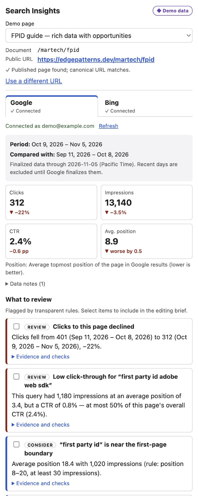
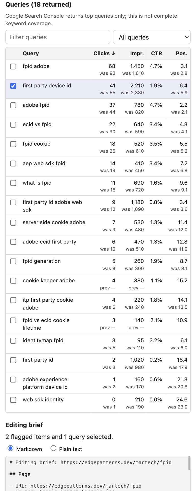

# Search Insights for Experience Workspace

An Adobe Experience Workspace library plugin that answers, for the page an author is editing:

> **What brings people to this page, what has changed, and what should I review or improve?**

It shows Google Search Console and Bing Webmaster Tools data for the page's public URL, flags a few evidence-based review items, and builds a copyable editing brief. Nothing is inserted, saved or published without an explicit click.

- **Frontend:** a small vanilla-JS micro-frontend using the [DA App SDK](https://www.aem.live/docs/ew/developing/apps-plugins). There is no framework and no build step.
- **Backend:** a Cloudflare Worker that handles provider OAuth, token storage, access control, provider calls and normalization. The business logic is platform-independent (see [Hosting](#hosting-and-app-builder)).
- **Providers:** Google Search Console (Search Analytics and URL Inspection APIs, read-only OAuth) and Bing Webmaster Tools (JSON API, API key or OAuth).
- **Demo mode:** clearly labelled fixtures for reviewers without credentials: `https://<your-worker>/?demo`.

 

_Screenshots use clearly labelled demo fixtures; see docs/verification.md for what has been tested live._

---

## Contents

1. [How it works](#how-it-works)
2. [Required accounts and permissions](#required-accounts-and-permissions)
3. [Configure your site](#configure-your-site)
4. [Google Search Console setup](#google-search-console-setup)
5. [Bing Webmaster Tools setup](#bing-webmaster-tools-setup)
6. [Secrets](#secrets)
7. [Deploy the backend and frontend](#deploy-the-backend-and-frontend)
8. [Register the plugin in Experience Workspace](#register-the-plugin-in-experience-workspace)
9. [Local development](#local-development)
10. [Production-domain mapping](#production-domain-mapping)
11. [Using another site instead of edgepatterns.dev](#using-another-site-instead-of-edgepatternsdev)
12. [Known limits and unsupported features](#known-limits-and-unsupported-features)
13. [Tests](#tests)
14. [More documentation](#more-documentation)

---

## How it works

```
Experience Workspace (da.live)                        Cloudflare Worker (same origin as plugin)
┌───────────────────────────────┐   iframe   ┌──────────────────────────────────────────────┐
│ Document editor               │──────────▶│ /            plugin (web/)                    │
│  Library ▸ "Search Insights"  │            │ /api/*       Bearer = Workspace IMS token     │
│                               │◀─ SDK ────│   1. IMS validate_token                        │
│  context {org, site, path}    │  postMsg   │   2. DA admin /list/{org}/{site} → 200        │
│  token (IMS)                  │            │   3. optional user allowlist                   │
│  actions.sendHTML (insert)    │            │ /oauth/{google|bing}/callback                  │
└───────────────────────────────┘            │ KV: encrypted refresh tokens, state, cache     │
                                             └───────────┬─────────────────────┬────────────┘
                                                         ▼                     ▼
                                          Google Search Analytics API   Bing Webmaster JSON API
```

1. The author opens a page in Experience Workspace and opens **Search Insights** from the library.
2. The plugin reads the verified SDK context (`org`, `site`, `path`). It then resolves the **public URL** from the configured production origin, never from where the plugin is hosted.
3. It checks the published page's canonical link through the backend, which only fetches URLs on the configured origin.
4. On each tab (Google, Bing) the author connects once with OAuth in a popup. Bing can instead use a deployment API key. The tab then shows:
   - the period with actual dates and freshness
   - on Google, the page's **index status** from URL Inspection: indexed or not and why, last crawl, Google-selected versus declared canonical, and rich-result errors
   - page totals with changes (CTR in percentage points, lower position = better)
   - opportunity cards
   - a sortable and filterable query table
5. The author selects queries and cards, previews the brief, and copies it as Markdown or plain text. The author can optionally insert it at the cursor after confirming.

## Required accounts and permissions

| What | Why |
| --- | --- |
| Experience Workspace / DA access to the site (`https://da.live/#/{org}/{site}`) | To edit the site config (`library` sheet) and to use the plugin. Every user of the plugin must be able to read the site in DA. |
| Cloudflare account (free plan is enough) | Hosts the Worker, static assets and a KV namespace. |
| Google account that is a user of the Search Console property | Each author connects their own Google account; Google enforces property access. |
| Google Cloud project | OAuth client and Search Console API enablement. |
| Bing Webmaster Tools account with the site verified | API key (single-site install) or OAuth client. |
| Node.js 20+ and npm | Tests and Wrangler. |

## Configure your site

Site configuration is **non-secret** and lives in the `SITES` variable of `wrangler.jsonc`.

```bash
cp wrangler.example.jsonc wrangler.jsonc
cp .dev.vars.example .dev.vars
npm install
```

Edit the `SITES.sites[]` entry:

| Field | Meaning |
| --- | --- |
| `id` | Short identifier used in cache keys. |
| `da.org`, `da.site` | Experience Workspace org and site (from `https://da.live/#/{org}/{site}`). Requests for any other org/site are refused. |
| `productionOrigin` | The public HTTPS origin search engines index, e.g. `https://edgepatterns.dev`. |
| `paths` | URL mapping rules (see [Production-domain mapping](#production-domain-mapping)). |
| `google.properties` | Search Console properties this site may query, in order of preference: `sc-domain:example.com` (Domain property) and/or `https://example.com/` (URL-prefix property). |
| `google.maxQueryRows` | Query rows loaded per period (default 1000, max 25000 per request; paginated). |
| `bing.siteUrl` | The verified Bing site, e.g. `https://example.com/`. The backend never queries another site, even if the API key covers more. |
| `bing.auth` | `"apiKey"` (deployment-owned key, single-site install) or `"oauth"` (each author connects). |
| `access.allowedUserIds` | Optional list of Adobe IMS user ids allowed to use the backend. Empty means anyone who can read the site in DA. Recommended when Bing uses a shared API key. |
| `reportingDays` | Period length: 7, 28 (default) or 90. |
| `thresholds` | Overrides for opportunity rules (see [docs/metrics-and-opportunities.md](docs/metrics-and-opportunities.md)). |

Run `npm run check-config` to validate it.

## Google Search Console setup

1. **Create or choose a Google Cloud project:** go to <https://console.cloud.google.com/projectcreate>.
2. **Enable the API:** APIs & Services → Library → **Google Search Console API** → Enable. With the CLI:
   ```bash
   gcloud services enable searchconsole.googleapis.com --project YOUR_PROJECT
   ```
3. **Configure the consent screen:** Google Auth Platform → Branding / Audience.
   - User type: **External**, unless all authors share one Google Workspace organisation (then **Internal**).
   - App name "Search Insights", plus support and developer emails.
   - Data access / scopes: add `.../auth/webmasters.readonly`, `openid` and `email`.
   - Audience: while the app is in **Testing**, add each author's Google account under **Test users**.
4. **Create the OAuth client:** Google Auth Platform → Clients → Create client → **Web application**.
   - Authorized redirect URIs:
     - `https://<your-worker>.workers.dev/oauth/google/callback` (or your `PUBLIC_BASE_URL` + `/oauth/google/callback`)
     - `http://localhost:8787/oauth/google/callback` (local development)
   - No JavaScript origins are needed: the browser never talks to Google directly.
5. **Store the credentials** in the Worker's secret store (no redeploy needed):
   ```bash
   npx wrangler secret put GOOGLE_CLIENT_ID      # not secret, but stored here for convenience
   npx wrangler secret put GOOGLE_CLIENT_SECRET
   ```
6. **Check Search Console access:** at <https://search.google.com/search-console/users>, confirm each author's Google account is a user (Full or Restricted) of the property listed in `google.properties`.

**Distribution limits**
- `webmasters.readonly` is a *sensitive* scope. While the app is in Testing, only listed test users can connect. Google also expires their refresh tokens after **7 days**, and Search Insights then shows "Reauthorization required".
- To remove both limits, publish the app ("In production"). Using a sensitive scope then requires Google's OAuth verification for External apps, unless the app is Internal to a Workspace organisation.

## Bing Webmaster Tools setup

Bing's SOAP and POX endpoints were retired on 2026-08-31. Search Insights uses only the JSON endpoints (`/webmaster/api.svc/json/...`).

**Option A: deployment API key** (`"bing": { "auth": "apiKey" }`). This is the simplest option for a single-site install.
1. Sign in at <https://www.bing.com/webmasters>. Add and verify the site if needed.
2. Settings (gear) → **API Access** → accept the terms → **API Key** → Generate.
3. Store it as a secret: `npx wrangler secret put BING_API_KEY`.
4. A Bing key covers every site the Bing user has verified. The backend therefore only ever calls the configured `bing.siteUrl` and only for URLs on `productionOrigin`. Set `access.allowedUserIds` to restrict who can read this shared data.

**Option B: OAuth** (`"bing": { "auth": "oauth" }`). Use this to distribute to sites whose Bing data belongs to the authors.
1. Bing Webmaster Tools → Settings → API Access → **OAuth Client**.
2. Register redirect URI `https://<your-worker>.workers.dev/oauth/bing/callback`.
3. Run `npx wrangler secret put BING_CLIENT_ID` and `npx wrangler secret put BING_CLIENT_SECRET`.
4. Search Insights requests the `webmaster.read` scope. Bing does not document PKCE, so the flow uses server-side `state` only.

## Secrets

All secrets live only in the platform secret store, never in the repository, `wrangler.jsonc` or the browser.

| Secret | Required | How to set |
| --- | --- | --- |
| `GOOGLE_CLIENT_ID` | for Google | `npx wrangler secret put GOOGLE_CLIENT_ID` (not secret, but kept here) |
| `BING_CLIENT_ID` | for Bing `oauth` mode | `npx wrangler secret put BING_CLIENT_ID` (not secret, but kept here) |
| `TOKEN_ENCRYPTION_KEY` | yes | `node -e "process.stdout.write(require('crypto').randomBytes(32).toString('base64url'))" \| npx wrangler secret put TOKEN_ENCRYPTION_KEY` |
| `GOOGLE_CLIENT_SECRET` | for Google | `npx wrangler secret put GOOGLE_CLIENT_SECRET` |
| `BING_API_KEY` | for Bing `apiKey` mode | `npx wrangler secret put BING_API_KEY` |
| `BING_CLIENT_SECRET` | for Bing `oauth` mode | `npx wrangler secret put BING_CLIENT_SECRET` |

- **Encryption at rest:** refresh tokens, access tokens, OAuth state and cached reports are encrypted with AES-256-GCM. Each value is bound to its KV key.
- **Rotating `TOKEN_ENCRYPTION_KEY`:** this invalidates stored connections, and authors simply reconnect.
- **Local development:** put secrets in `.dev.vars`, which is git-ignored.
- **Another machine:** add `--name <worker-name>` to run `wrangler secret put` without a local `wrangler.jsonc`, e.g. `npx wrangler secret put GOOGLE_CLIENT_SECRET --name search-insights`.

## Deploy the backend and frontend

The Worker serves both the plugin (`web/`, as static assets) and the API (`/api/*`, `/oauth/*`) from one origin.

```bash
npx wrangler login
npx wrangler kv namespace create SI_KV        # copy the id into wrangler.jsonc → kv_namespaces[0].id
# set secrets (see above)
npm test
npx wrangler deploy                           # prints https://search-insights.<account>.workers.dev
curl https://search-insights.<account>.workers.dev/api/health   # {"ok":true,"encryptionKey":true}
```

- **Custom domain:** to serve from your own domain, add it in Cloudflare (Workers → your worker → Settings → Domains & Routes).
- **Fixed callback base:** set `vars.PUBLIC_BASE_URL` so OAuth redirect URIs use that origin, and register those redirect URIs with Google and Bing.
- **Frame embedding:** `web/_headers` only lets `https://da.live` and `https://*.da.live` frame the plugin (`frame-ancestors`).

## Register the plugin in Experience Workspace

This uses the documented `library` sheet in the site configuration ([Set up library](https://www.aem.live/docs/ew/administering/set-up-library)).

1. Open `https://da.live/config#/{org}/{site}/`.
2. Open the **library** tab, or add one. **Add a row; do not change existing rows.**

| title | path | icon | ref | experience |
| --- | --- | --- | --- | --- |
| Search Insights | `https://search-insights.<account>.workers.dev/` | | | |

The columns:
- `title` (required) is shown to authors.
- `path` (required) is the full URL of the deployed plugin. Absolute non-`aem.live` URLs are loaded as-is, without DA's preview proxy.
- `icon` (optional) is a fully-qualified icon URL.
- `ref` (optional) gates the row to `?ref=<value>` in the Workspace URL. Rows without `ref` (or `main`) are visible to everyone.
- `experience` (optional) controls how the plugin opens. Leave it empty for the side panel, or use `fullsize-dialog` for a large dialog. Both are verified in DA source. `window` opens a new tab and is not supported, because the SDK handshake requires an iframe.

3. Save the sheet (paper-plane icon, then **Save**). Open any page in Canvas, e.g. `https://da.live/canvas#/{org}/{site}/index`, open the **side-panel switcher**, and choose **Search Insights**. It sits next to Outline, Page, Files, Versions and Comments.

A machine-readable example is in [`config/library-sheet.example.json`](config/library-sheet.example.json).

## Local development

```bash
npm install
cp wrangler.example.jsonc wrangler.jsonc     # any KV id works locally
cp .dev.vars.example .dev.vars               # set TOKEN_ENCRYPTION_KEY (and provider secrets for live data)
npm run dev                                  # http://localhost:8787
```

- **Demo mode:** open `http://localhost:8787/?demo`. It needs no credentials and no Workspace.
- **Inside Workspace:** add a *second* library row so the production row stays untouched:

  | title | path | ref |
  | --- | --- | --- |
  | Search Insights (local) | `http://localhost:8787/` | `local` |

  Rows with a `ref` only appear when the Workspace URL carries the same `?ref=`, e.g. `https://da.live/canvas?ref=local#/{org}/{site}/{path}`. You can also leave `ref` empty so the local row is always visible. The first time Workspace loads a localhost plugin, it asks you to allow the local connection. DA rewrites *relative* paths to `http://localhost:3000`; this row's absolute path points at Wrangler instead.
- **Local OAuth:** for Google, register `http://localhost:8787/oauth/google/callback` as an additional redirect URI. `.dev.vars` sets `PUBLIC_BASE_URL=http://localhost:8787`.

## Production-domain mapping

Search engines report on public URLs, not on editor or preview URLs. The resolver ([`web/core/url-resolver.js`](web/core/url-resolver.js)) maps a Workspace document path to `productionOrigin + publicPath` in this order:

1. A `.html` / `.htm` extension is removed.
2. Other extensions (`.json` sheets, media) are not pages.
3. `paths.excludedPrefixes` (default `/drafts/`, `/tools/`, `/library/`, `/fragments/`, `/.da/`) and `paths.excludedPaths` (`/nav`, `/footer`, …) are not public.
4. `…/index` maps to the folder URL with a trailing slash. For example, `/index` becomes `/` and `/de/index` becomes `/de/`. Edge Delivery serves `/de` as 404.
5. `paths.trailingSlash`:
   - `folders-only` (default, Edge Delivery behaviour)
   - `never`
   - `always`
6. `paths.mappings`: the first matching prefix rewrite. For example, `[{ "from": "/en/", "to": "/" }]` handles a site that publishes `/en/*` at the root.
7. Each segment is encoded exactly once.
8. Uppercase paths ask the author to confirm.

Other mapping behaviour:
- **Shown to the author:** the resolved URL appears prominently.
- **Canonical check:** the backend reads the published page's `<link rel="canonical">`. It follows at most three same-origin redirects. If the canonical URL differs, the author is offered "Use canonical URL".
- **Unpublished pages:** a 404 shows "This URL is not published".
- **Manual override:** the author can enter a different URL. It must be on `productionOrigin`. Preview and live URLs of the same DA site (`*--{site}--{org}.aem.page|live`) are mapped automatically, and anything else is refused, both in the browser and on the server.

## Using another site instead of edgepatterns.dev

1. Copy the `edgepatterns` entry in `SITES.sites` and change:
   - `id`
   - `da.org` / `da.site`
   - `productionOrigin`
   - `google.properties`
   - `bing.siteUrl`
   - path rules, if your URLs differ from Edge Delivery defaults

   One deployment can serve several sites.
2. Register the Google redirect URI (unchanged if you reuse the same Worker) and add your authors as test users if the app is in Testing.
3. Generate a Bing key for an account that verified your site, and store it as a secret. Use a separate deployment if the key must not be shared.
4. Run `npm run check-config && npm test && npx wrangler deploy`.
5. Add the library row to *your* site config.

## Known limits and unsupported features

**Google**
- Search Console returns **top rows only** and omits anonymised queries. Query rows never sum to page totals, and the UI says how much of the page's clicks they cover.
- Only **finalized** data (`dataState: final`) is used. The period ends on the latest finalized date for the property, which is usually 2–3 days ago. Dates are Pacific Time calendar days.
- Search type is `web` only. Discover, News, Image and Video are not included.
- URL Inspection reports Google's **indexed** version, not a live test. It is limited to 2,000 inspections per day and 600 per minute per property, so results are cached for 1 hour per user, property and URL.
- Queries are loaded with `rowLimit` 1000 by default (configurable up to 25,000 per request, paginated with `startRow`).

**Bing**
- The page and query APIs (`GetPageQueryStats`, `GetPageStats`) take **no date range**. Bing documents that the data "will be updated every week".
- Search Insights groups the dated rows Bing returns into a period ending at the latest row date. It shows a comparison only when the previous period has the same number of row dates; otherwise the UI states that no comparison is available.
- If the page is not in Bing's top pages (`GetPageStats`), totals are summed from query rows. This is labelled and may undercount.
- Bing position is `AvgImpressionPosition`, impression-weighted across rows. It is not comparable with Google position.
- Bing figures are search statistics, **not** Copilot citations or AI-answer visibility.

**Not included by design**
- Search Console reports with no API (Core Web Vitals, Links, Manual actions, Security issues). Core Web Vitals per page are better covered by Edge Delivery's real-user monitoring (RUM).
- Site-wide dashboards, scheduled monitoring, rank tracking, automatic edits or publishing, Jira, general SEO audits.
- Providers are never blended: Google and Bing stay on separate tabs.
- Optional AI enrichment of the brief is not implemented. The deterministic brief works without any AI service.

**Hosting and App Builder**
- The challenge announcement mentions Adobe App Builder and UI Extensibility. Experience Workspace's documentation describes a different mechanism: DA App SDK micro-frontends in an iframe, configured through the `library` sheet. See [docs/workspace-integration.md](docs/workspace-integration.md).
- The frontend follows the Workspace SDK. The backend runs on Cloudflare Workers, but all logic in `worker/app.js` and `web/core/` depends only on `fetch`, WebCrypto and a three-method key-value store (`worker/store.js`).
- Porting to App Builder Runtime means wrapping `handle()` in an action and implementing the store with `@adobe/aio-lib-state`. This has not been done or tested.

## Tests

```bash
npm test
```

There are 91 focused tests (`node:test`, no dependencies) covering:
- URL mapping
- comparison windows and date boundaries
- CTR and percentage points
- zero baselines and missing rows
- Google and Bing normalization
- low-volume suppression
- site and property authorization
- OAuth state and PKCE
- URL Inspection normalization, caching and access checks
- encryption binding
- secret redaction
- safe page fetching

## More documentation

- [docs/workspace-integration.md](docs/workspace-integration.md): verified SDK and host integration points, plus the App Builder discrepancy.
- [docs/authentication.md](docs/authentication.md): authentication model, iframe and popup behaviour, and troubleshooting.
- [docs/metrics-and-opportunities.md](docs/metrics-and-opportunities.md): metric definitions, opportunity rules and thresholds.
- [docs/verification.md](docs/verification.md): what was tested live, with fixtures, or not at all.
- [docs/demo-script.md](docs/demo-script.md): a 2–3 minute demo.
- [docs/marketplace.md](docs/marketplace.md): suggested listing text and feature summary.

## License

Apache-2.0
