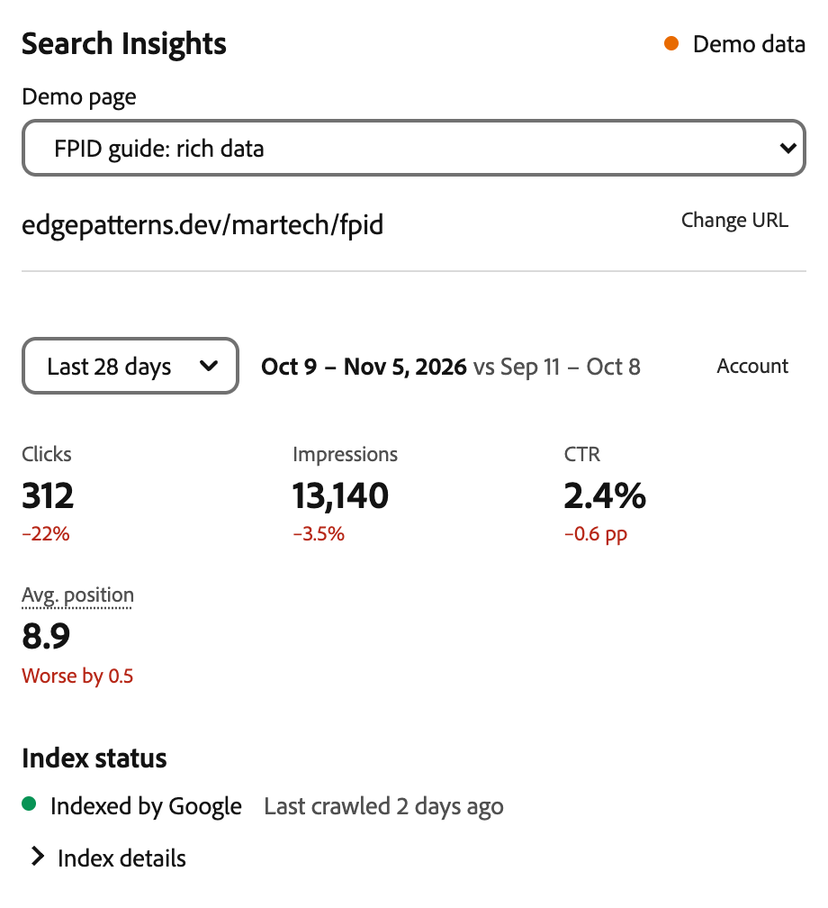
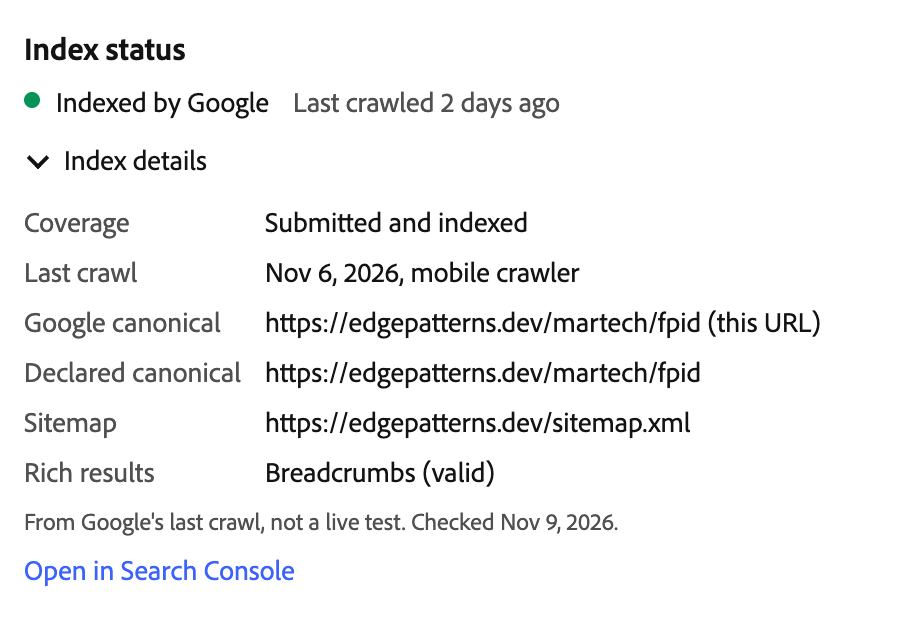
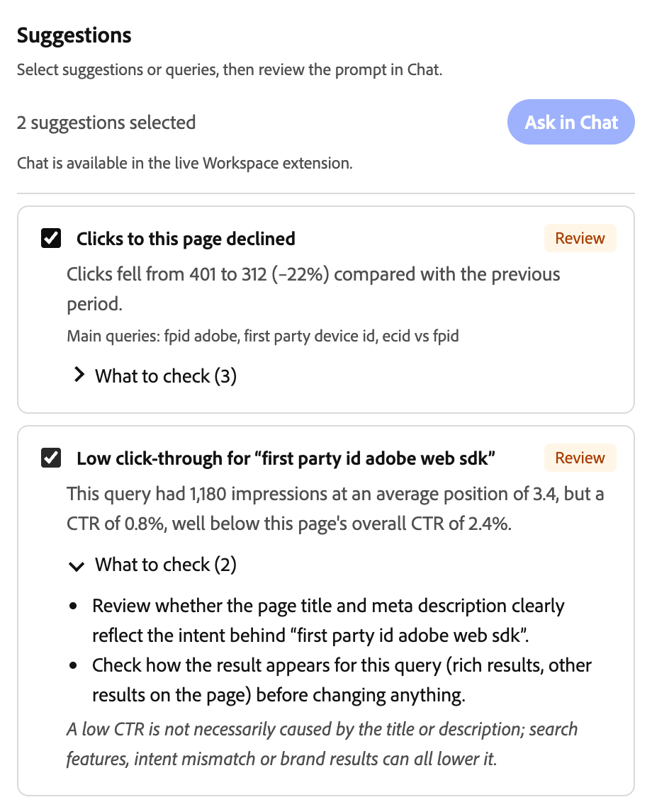
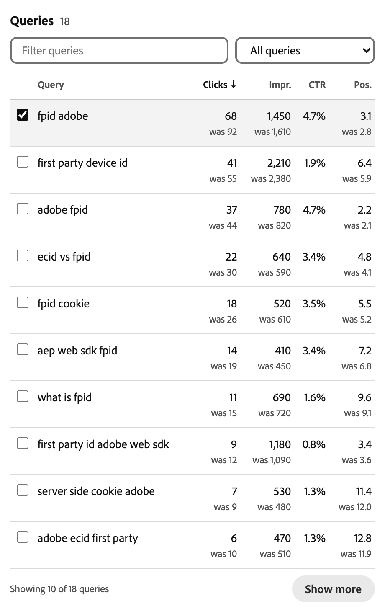
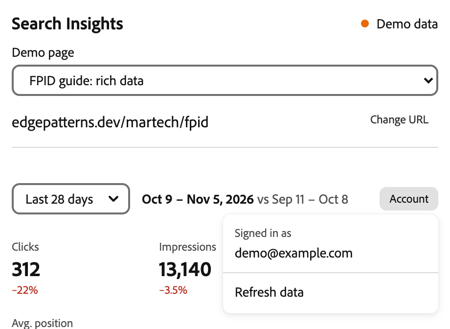

# Search Insights for Experience Workspace

Search Insights is an Experience Workspace extension that shows Google Search Console data for the page you are editing. It opens in the side panel next to the document, works out the page's public URL, and shows how that page performs in Google search: clicks, impressions, the queries people used, and whether Google has indexed it.

Authors usually have to leave the editor for this. They open Search Console in another tab, find the property, filter by page, set the dates and copy numbers back. Search Insights does those steps for the open document and keeps the author in the editor.



_Screenshots in this README use demo mode (`?demo`), so the numbers are fixtures and no real account appears. [Verification](docs/verification.md) records what was tested against live Search Console data._

- **Try the demo:** <https://search.edgepatterns.dev/?demo&providers=google>. No sign-in needed.
- **Frontend:** vanilla JavaScript using the [DA App SDK](https://www.aem.live/docs/ew/developing/apps-plugins) and Workspace's own Spectrum 2 styles from `da.live`. No framework, no build step.
- **Backend:** a Cloudflare Worker for OAuth, token storage, access checks and the Google and Bing API calls. The logic does not depend on Cloudflare (see [Hosting](#hosting-and-app-builder)).
- **Providers:** Google Search Console (Search Analytics and URL Inspection, read-only scope). Bing Webmaster Tools is implemented and gets its own tab when configured.

---

## Contents

1. [What the panel shows](#what-the-panel-shows)
2. [Why it works this way](#why-it-works-this-way)
3. [How it works](#how-it-works)
4. [Required accounts and permissions](#required-accounts-and-permissions)
5. [Deployment options](#deployment-options)
6. [Configure your site](#configure-your-site)
7. [Google Search Console setup](#google-search-console-setup)
8. [Bing Webmaster Tools setup](#bing-webmaster-tools-setup)
9. [Secrets](#secrets)
10. [Deploy the backend and frontend](#deploy-the-backend-and-frontend)
11. [Register the plugin in Experience Workspace](#register-the-plugin-in-experience-workspace)
12. [Local development](#local-development)
13. [Production-domain mapping](#production-domain-mapping)
14. [Using another site instead of edgepatterns.dev](#using-another-site-instead-of-edgepatternsdev)
15. [Known limits and unsupported features](#known-limits-and-unsupported-features)
16. [Tests](#tests)
17. [More documentation](#more-documentation)

---

## What the panel shows

The author opens a document in Experience Workspace and picks **Search Insights** from the side-panel switcher. The panel reads the document path from the SDK and maps it to the public URL. In the example, `/martech/fpid` in DA becomes `edgepatterns.dev/martech/fpid`. **Change URL** lets the author pick another URL on the same site.

### Period and page totals

The period picker offers 7, 28 or 90 days. Each period is compared with the previous period of the same length, and the dates are shown next to the picker. The period ends on the last day Google has finalized, usually two or three days ago.

Below it are the page totals: clicks, impressions, click-through rate (CTR) and average position. CTR changes are in percentage points. For position, a lower number is better, so the panel says "Worse by 0.5" rather than showing a bare "+0.5".

### Index status



The panel asks Google's URL Inspection API whether the page is indexed. The one-line summary is enough most of the time. **Index details** shows the coverage state, last crawl, the canonical Google picked compared with the one the page declares, the sitemap and any rich results. This is Google's stored result from its last crawl, not a live test.

### Suggestions



Suggestions are rule-based, not AI-generated. Each one is backed by numbers from the report:

| Suggestion | Shown when |
| --- | --- |
| Clicks to this page declined | Clicks fell by at least 20% and at least 5 clicks, from a previous period with 20 or more |
| Low click-through for a query | A query has 100+ impressions and a top-10 position, but its CTR is under half the page's CTR |
| Near the first-page boundary | A query has 30+ impressions and an average position between 8 and 20 |
| Appears in this period's data | A query has 30+ impressions now but was not in the previous period's returned rows |

Each card has a **What to check** list and a caveat. Pages with fewer than 100 impressions in the period get no suggestions, and the panel says why. Thresholds are in [docs/metrics-and-opportunities.md](docs/metrics-and-opportunities.md) and can be changed per site.

### Ask in Chat

The author ticks the suggestions or queries that matter and clicks **Ask in Chat**. Search Insights builds a prompt from the selection and passes it to Workspace AI with the SDK's `setPrompt` action. The prompt appears in Chat for the author to read, edit and send. Nothing is sent automatically, and Search Insights never edits the document.

In demo mode the button is disabled, because there is no Workspace host to receive the prompt.

<details>
<summary>Example prompt for one selected suggestion and one selected query</summary>

```text
Use these Search Insights results as evidence when helping me improve the page.
Suggest specific edits only where supported by the selected queries and checks.
Do not invent causes for performance changes or promise ranking gains.
Ask before changing or replacing document content.

## Page
- URL: https://edgepatterns.dev/martech/fpid
- Source: Google Search Console (sc-domain:edgepatterns.dev)
- Period: Oct 9, 2026 – Nov 5, 2026, compared with Sep 11, 2026 – Oct 8, 2026
- Google index status (inspected 2026-11-09; reflects Google's indexed version): Indexed by Google – Submitted and indexed

## What changed
- Clicks: 401 → 312 (−22%)
- CTR: 2.9% → 2.4% (−0.6 pp)
- Average position: 8.4 → 8.9 (worsened by 0.5; lower is better)
- These are observed changes; they do not by themselves explain why traffic changed.

## Selected queries
- “fpid adobe” — 1,450 impressions, 68 clicks, CTR 4.7%, avg. position 3.1 (previous period: 92 clicks, 1,610 impressions, position 2.8)

## Flagged items
- Low click-through for “first party id adobe web sdk”: This query had 1,180 impressions at an average position of 3.4, but a CTR of 0.8%, well below this page's overall CTR of 2.4%.

## Suggested checks
- Review whether the page title and meta description clearly reflect the intent behind “first party id adobe web sdk”.
- Check how the result appears for this query (rich results, other results on the page) before changing anything.

## Caveats
- A low CTR is not necessarily caused by the title or description; search features, intent mismatch or brand results can all lower it.
- Google Search Console returns top rows only and omits some queries; the query list is not complete keyword coverage.
```

Shortened. The full prompt also lists page totals, freshness, last crawl and canonical. It is built by [`web/core/brief.js`](web/core/brief.js).
</details>

### Queries



The query table lists the queries Google returned for the page, with the previous period's value under each number. Columns sort on click. The filter box and the menu (position 8 to 20, CTR below page CTR, not in previous rows, selected only) apply to all returned rows. The table shows 10 rows at a time, and **Show more** adds 10 without losing selections. A note under the table says what share of the page's clicks the listed queries cover, because Google omits some queries.

### Account



Each author connects their own Google account once, in a popup. The account stays out of sight until the author opens **Account**, so it does not appear in screen shares. The menu also has **Refresh data** and **Disconnect**. If the author's account can reach more than one allowed property, a property picker appears there too.

## Why it works this way

- **The author decides.** The panel shows evidence and drafts a prompt. It does not rewrite titles, publish, or send anything to Chat without the author pressing send. Search data is too noisy to act on automatically.
- **Numbers are not stretched.** Page totals come from Google's page totals, not from adding up query rows. A query missing from the previous period is shown as missing, not as zero. Low-traffic pages get no suggestions.
- **Only what applies is shown.** Bing appears only when it is configured. The property picker appears only when there is a choice. Index details and suggestion checks stay collapsed until opened.
- **It looks like Workspace.** The panel loads Workspace's Spectrum 2 stylesheet from `da.live` and uses its tokens and controls, so it matches Outline, Versions and the other side panels in light and dark themes.
- **Google and Bing stay separate.** They measure position differently, so their numbers are never blended.

## How it works

```
Experience Workspace (da.live)                        Cloudflare Worker (same origin as plugin)
┌───────────────────────────────┐   iframe   ┌──────────────────────────────────────────────┐
│ Document editor               │──────────▶│ /            plugin (web/)                    │
│  Side panel ▸ Search Insights │            │ /api/*       Bearer = Workspace IMS token     │
│                               │◀─ SDK ────│   1. IMS validate_token                        │
│  context {org, site, path}    │  postMsg   │   2. DA admin /list/{org}/{site} → 200        │
│  token (IMS)                  │            │   3. optional user allowlist                   │
│  actions.setPrompt (chat)     │            │ /oauth/{google|bing}/callback                  │
└───────────────────────────────┘            │ KV: encrypted refresh tokens, state, cache     │
                                             └───────────┬─────────────────────┬────────────┘
                                                         ▼                     ▼
                                          Google Search Console APIs    Bing Webmaster JSON API
```

1. Workspace loads the panel in an iframe from a row in the site's `library` sheet. The DA App SDK passes the document context (`org`, `site`, `path`) and the author's Adobe token.
2. The panel maps the path to the public URL using the site's configured production origin. The backend fetches the published page and checks its canonical link.
3. Every API call carries the Adobe token. The Worker validates it with Adobe IMS and checks that the author can read the site in DA. Opening the panel is not enough.
4. The Worker calls Google with the author's own OAuth token. Refresh tokens are encrypted before they are stored in Workers KV. Each site may only query its configured origin and Search Console properties.
5. The Worker normalizes both periods into one report and caches it per user, property, URL and period. The panel builds the suggestions and the Chat prompt in the browser.

## Required accounts and permissions

| What | Why |
| --- | --- |
| Experience Workspace / DA access to the site (`https://da.live/#/{org}/{site}`) | To edit the site config (`library` sheet) and to use the plugin. Every user of the plugin must be able to read the site in DA. |
| Cloudflare account (free plan for demos; see [Deployment options](#deployment-options) for production) | Hosts the Worker, static assets and a KV namespace. |
| Google account that is a user of the Search Console property | Each author connects their own Google account; Google enforces property access. |
| Google Cloud project | OAuth client and Search Console API enablement. |
| Bing Webmaster Tools account with the site verified | API key (single-site install) or OAuth client. |
| Node.js 20+ and npm | Tests and Wrangler. |

## Deployment options

Every deployment has the same three parts:

- **Host:** runs the backend and serves the panel. This repository ships a Cloudflare Worker.
- **Google OAuth app:** a Google Cloud project with the Search Console API enabled and an OAuth client. Authors see its name on Google's consent screen.
- **Site entry:** one item in `SITES` that ties an Experience Workspace org/site to a production origin and Search Console property.

The choice is who owns the first two. Search Console access is always per author: each author's own Google account must be a user of the property, whichever option you pick.

| Option | Who owns the host and OAuth app | Use it when | Trade-offs |
| --- | --- | --- | --- |
| **A. Self-hosted** (recommended for customers) | The customer: their Cloudflare account and their Google Cloud project | A customer runs it in production | The customer holds all secrets and encrypted tokens and controls the consent screen. They complete Google's OAuth verification or use an Internal app (option C). |
| **B. Shared instance** | The operator of an existing deployment, e.g. the reference install | Demos, pilots, a handful of known authors | Only a new `SITES` entry and a library row are needed. The operator stores the customer's authors' encrypted tokens, and their consent screen shows the operator's app name. In Testing mode, the operator adds each author as a test user, and the 7-day token expiry applies. Not suitable for production use by another company. |
| **C. Self-hosted, Internal Google app** | The customer, with the consent screen set to **Internal** | All authors sign in with the customer's Google Workspace domain | No test-user list, no 7-day expiry and no Google verification. Authors outside that Google Workspace organisation cannot connect. |
| **D. Another host** (App Builder, Node.js, another edge platform) | The customer | Cloudflare is not an approved vendor, or the customer wants Adobe-hosted infrastructure | Requires a small adapter that has not been built or tested. See [Hosting and App Builder](#hosting-and-app-builder). |

**What a customer does for option A or C**

1. Fork or copy this repository.
2. Create a Google Cloud project and OAuth client ([Google Search Console setup](#google-search-console-setup)), registering the callback on their own Worker URL or custom domain.
3. Create a Cloudflare account, a KV namespace and the secrets ([Secrets](#secrets)), then deploy ([Deploy the backend and frontend](#deploy-the-backend-and-frontend)).
4. Replace the `edgepatterns` entry in `SITES` with their own site ([Using another site](#using-another-site-instead-of-edgepatternsdev)).
5. Add the library row to their site config ([Register the plugin](#register-the-plugin-in-experience-workspace)).
6. Make sure every author is a user of the Search Console property.

Bing is optional in every option. Its tab is hidden if the `bing` section or its deployment credentials are missing.

**Running costs:** the Search Console API has no charge, but its quotas apply per Google Cloud project. Authors on a shared instance (option B) therefore share one quota. The Cloudflare Workers free plan covers a demo or a small team. Its KV limit of 1,000 writes per day (checked 11 November 2026) is the first limit a wider rollout will hit, because connections, OAuth state and report caches are written to KV. Use the Workers Paid plan for production.

### Hosting and App Builder

The Cloudflare code is a thin layer. [`worker/index.js`](worker/index.js) is about 15 lines, and everything else calls `handle(request, { env, store, fetchImpl })` in [`worker/app.js`](worker/app.js). That function uses only standard `fetch`, `Request`/`Response` and WebCrypto, plus a store with `get`, `put` (with TTL) and `delete`. Any host that provides those can run it.

To move to another host, provide four things:

| Need | Cloudflare today | What another host must provide |
| --- | --- | --- |
| Request handler | `fetch` export in `worker/index.js` | An adapter that turns the platform's request into a standard `Request`, calls `handle()` for `/api/*` and `/oauth/*`, and returns its `Response`. |
| Store | Workers KV via `kvStore()` in [`worker/store.js`](worker/store.js) | Any key-value store with per-key expiry, e.g. Redis, DynamoDB or App Builder State. Values are already encrypted by `secureStore()`. |
| Static files | Workers Static Assets serving `web/` | Static hosting on the **same origin** as the API, because [`web/api.js`](web/api.js) uses relative `/api/...` URLs and the CSP allows `connect-src 'self'`. |
| Headers and config | `web/_headers`, `vars`, secrets | The security headers from `web/_headers` as real response headers (`frame-ancestors` cannot be set in a `<meta>` tag), `SITES` as a JSON string, and the secrets from [Secrets](#secrets). |

Examples:

- **Node.js 20+** (container, VM, Azure App Service, Cloud Run): Node has `fetch`, `Request`, `Response` and WebCrypto built in. Wrap `handle()` with a small HTTP adapter, serve `web/` with the headers above, and use Redis or a database for the store. Use a single instance or a shared store, because OAuth state is written on one request and read on the callback.
- **Other edge or serverless platforms** (Deno Deploy, Vercel, Netlify, AWS Lambda): the same adapter pattern applies, with the platform's key-value store.

None of these ports has been built or tested.

**Does App Builder add anything?** Adobe App Builder can host it: Runtime web actions for the API, App Builder State (`@adobe/aio-lib-state`) for the store, and Adobe's CDN for `web/`. It helps in these cases:

- The customer already has an App Builder entitlement and wants no third-party host or vendor review for Cloudflare.
- Hosting, credentials and support stay inside the customer's Adobe org and Adobe Developer Console project.
- App Builder State supports per-key TTLs of up to 365 days, which covers OAuth state, tokens and report caches.

It does not change the Workspace side. Experience Workspace loads this plugin through the DA App SDK and a `library` row, not through App Builder UI Extensibility (see [docs/workspace-integration.md](docs/workspace-integration.md#app-builder--ui-extensibility-discrepancy)). Google OAuth, Search Console permissions and DA site authorization also stay the same. Keep the backend's own IMS and DA checks even if you add `require-adobe-auth`, because only those checks confirm the author can read the configured DA site.

Points to resolve before an App Builder port:

- Actions run under `https://<namespace>.adobeioruntime.net/api/v1/web/...` and static files under `https://<namespace>.adobeio-static.net`. Those are different origins, so either add an API base URL to `web/api.js` and widen `connect-src`, or put both behind one domain. The OAuth callback URI changes too, so set `PUBLIC_BASE_URL` to the public action URL and register that URI with Google.
- Check that the static CDN can send `frame-ancestors https://da.live https://*.da.live`, otherwise Workspace may not be allowed to frame the panel.
- Check App Builder State's maximum value size against cached reports. Google reports can include up to 25,000 query rows.

For this challenge, Cloudflare is used because it gives one origin for the panel and API with a free account. App Builder is the natural choice for an Adobe customer who already has the entitlement.

## Configure your site

Site configuration is **non-secret** and lives in the `SITES` variable of `wrangler.jsonc`.

```bash
cp wrangler.example.jsonc wrangler.jsonc
cp .dev.vars.example .dev.vars
npm install
```

Edit the `SITES.sites[]` entry:

| Field | Meaning |
| --- | --- |
| `id` | Short identifier used in cache keys. |
| `da.org`, `da.site` | Experience Workspace org and site (from `https://da.live/#/{org}/{site}`). Requests for any other org/site are refused. |
| `productionOrigin` | The public HTTPS origin search engines index, e.g. `https://edgepatterns.dev`. |
| `paths` | URL mapping rules (see [Production-domain mapping](#production-domain-mapping)). |
| `google.properties` | Search Console properties this site may query, in order of preference: `sc-domain:example.com` (Domain property) and/or `https://example.com/` (URL-prefix property). |
| `google.maxQueryRows` | Query rows loaded per period (default 1000, max 25000 per request; paginated). |
| `bing` | Optional. Omit the whole `bing` section to hide its tab, or leave it unconfigured until credentials are available. Omitting `google` also hides its tab. |
| `bing.siteUrl` | The verified Bing site, e.g. `https://example.com/`. The backend never queries another site, even if the API key covers more. |
| `bing.auth` | `"apiKey"` (deployment-owned key, single-site install) or `"oauth"` (each author connects). |
| `access.allowedUserIds` | Optional list of Adobe IMS user ids allowed to use the backend. Empty means anyone who can read the site in DA. Recommended when Bing uses a shared API key. |
| `reportingDays` | Default period length: 7, 28 (default) or 90. Users can switch between these in the panel; each is compared with the previous period of the same length. |
| `thresholds` | Overrides for opportunity rules (see [docs/metrics-and-opportunities.md](docs/metrics-and-opportunities.md)). |

Run `npm run check-config` to validate it.

## Google Search Console setup

1. **Create or choose a Google Cloud project:** go to <https://console.cloud.google.com/projectcreate>.
2. **Enable the API:** APIs & Services → Library → **Google Search Console API** → Enable. With the CLI:
   ```bash
   gcloud services enable searchconsole.googleapis.com --project YOUR_PROJECT
   ```
3. **Configure the consent screen:** Google Auth Platform → Branding / Audience.
   - User type: **External**, unless all authors share one Google Workspace organisation (then **Internal**).
   - App name "Search Insights", plus support and developer emails.
   - Data access / scopes: add `https://www.googleapis.com/auth/webmasters.readonly`, `openid` and `email`.
   - Audience: while the app is in **Testing**, add each author's Google account under **Test users**.
   - Branding links: the Worker serves `/about`, `/privacy`, `/terms` and a 120×120 `/logo.png` from `web/`. Edit the operator name and contact in those files, use them as home page, privacy and terms links, and add the deployment's domain under **Authorized domains**. Uploading a logo to an External app in production triggers brand verification.
   - Google shows the redirect URI's domain on the consent screen ("Select what … can access") until the brand is verified, so set `PUBLIC_BASE_URL` to the domain you want authors to see.
   - On that screen, authors must tick the Search Console checkbox. If they don't, the callback reports that Search Console access was not granted.
4. **Create the OAuth client:** Google Auth Platform → Clients → Create client → **Web application**.
   - Authorized redirect URIs:
     - `https://<your-worker>.workers.dev/oauth/google/callback` (or your `PUBLIC_BASE_URL` + `/oauth/google/callback`)
     - `http://localhost:8787/oauth/google/callback` (local development)
   - No JavaScript origins are needed: authorization uses a server-side flow.
5. **Store the credentials** in the Worker's secret store. In the Cloudflare dashboard, open Workers & Pages → your Worker → Settings → Variables and Secrets → Add. Add `GOOGLE_CLIENT_ID` and `GOOGLE_CLIENT_SECRET` as **Secret** variables, then select **Deploy**. Do not send the credentials in chat.

   Or use Wrangler, which deploys each secret immediately:
   ```bash
   npx wrangler secret put GOOGLE_CLIENT_ID      # not secret, but stored here for convenience
   npx wrangler secret put GOOGLE_CLIENT_SECRET
   ```
6. **Check Search Console access:** at <https://search.google.com/search-console/users>, confirm each author's Google account is a user (Full or Restricted) of the property listed in `google.properties`.

**Distribution limits**
- `webmasters.readonly` is a *sensitive* scope. While the app is in Testing, only listed test users can connect. Google also expires their refresh tokens after **7 days**, and Search Insights then shows "Reauthorization required".
- To remove both limits, publish the app ("In production"). Using a sensitive scope then requires Google's OAuth verification for External apps, unless the app is Internal to a Workspace organisation.

## Bing Webmaster Tools setup

Bing's SOAP and POX endpoints were retired on 2026-08-31. Search Insights uses only the JSON endpoints (`/webmaster/api.svc/json/...`).

**Option A: deployment API key** (`"bing": { "auth": "apiKey" }`). This is the simplest option for a single-site install.
1. Sign in at <https://www.bing.com/webmasters>. Add and verify the site if needed.
2. Settings (gear) → **API Access** → accept the terms → **API Key** → Generate.
3. Store it as a secret: `npx wrangler secret put BING_API_KEY`.
4. A Bing key covers every site the Bing user has verified. The backend therefore only ever calls the configured `bing.siteUrl` and only for URLs on `productionOrigin`. Set `access.allowedUserIds` to restrict who can read this shared data.

**Option B: OAuth** (`"bing": { "auth": "oauth" }`). Use this to distribute to sites whose Bing data belongs to the authors.
1. Bing Webmaster Tools → Settings → API Access → **OAuth Client**.
2. Register redirect URI `https://<your-worker>.workers.dev/oauth/bing/callback`.
3. Run `npx wrangler secret put BING_CLIENT_ID` and `npx wrangler secret put BING_CLIENT_SECRET`.
4. Search Insights requests the `webmaster.read` scope. Bing does not document PKCE, so the flow uses server-side `state` only.

## Secrets

All secrets live only in the platform secret store, never in the repository, `wrangler.jsonc` or the browser.

| Secret | Required | How to set |
| --- | --- | --- |
| `GOOGLE_CLIENT_ID` | for Google | `npx wrangler secret put GOOGLE_CLIENT_ID` (not secret, but kept here) |
| `BING_CLIENT_ID` | for Bing `oauth` mode | `npx wrangler secret put BING_CLIENT_ID` (not secret, but kept here) |
| `TOKEN_ENCRYPTION_KEY` | yes | `node -e "process.stdout.write(require('crypto').randomBytes(32).toString('base64url'))" \| npx wrangler secret put TOKEN_ENCRYPTION_KEY` |
| `GOOGLE_CLIENT_SECRET` | for Google | `npx wrangler secret put GOOGLE_CLIENT_SECRET` |
| `BING_API_KEY` | for Bing `apiKey` mode | `npx wrangler secret put BING_API_KEY` |
| `BING_CLIENT_SECRET` | for Bing `oauth` mode | `npx wrangler secret put BING_CLIENT_SECRET` |

- **Encryption at rest:** refresh tokens, access tokens, OAuth state and cached reports are encrypted with AES-256-GCM. Each value is bound to its KV key.
- **Rotating `TOKEN_ENCRYPTION_KEY`:** this invalidates stored connections, and authors simply reconnect.
- **Local development:** put secrets in `.dev.vars`, which is git-ignored.
- **Another machine:** add `--name <worker-name>` to run `wrangler secret put` without a local `wrangler.jsonc`, e.g. `npx wrangler secret put GOOGLE_CLIENT_SECRET --name search-insights`.

## Deploy the backend and frontend

The Worker serves both the plugin (`web/`, as static assets) and the API (`/api/*`, `/oauth/*`) from one origin.

```bash
npx wrangler login
npx wrangler kv namespace create SI_KV        # copy the id into wrangler.jsonc → kv_namespaces[0].id
# set secrets (see above)
npm test
npx wrangler deploy                           # prints https://search-insights.<account>.workers.dev
curl https://search-insights.<account>.workers.dev/api/health   # {"ok":true,"encryptionKey":true}
```

- **Custom domain:** to serve from your own domain, add it in Cloudflare (Workers → your worker → Settings → Domains & Routes).
- **Fixed callback base:** set `vars.PUBLIC_BASE_URL` so OAuth redirect URIs use that origin, and register those redirect URIs with Google and Bing.
- **Frame embedding:** `web/_headers` only lets `https://da.live` and `https://*.da.live` frame the plugin (`frame-ancestors`).
- **Workspace styles:** `web/_headers` permits styles and fonts from `https://da.live` for the shared Spectrum 2 assets. The panel retains local fallback styles if those assets are unavailable.

## Register the plugin in Experience Workspace

This uses the documented `library` sheet in the site configuration ([Set up library](https://www.aem.live/docs/ew/administering/set-up-library)).

1. Open `https://da.live/config#/{org}/{site}/`.
2. Open the **library** tab, or add one. **Add a row; do not change existing rows.**

| title | path | icon | ref | experience |
| --- | --- | --- | --- | --- |
| Search Insights | `https://search-insights.<account>.workers.dev/` | | | |

The columns:
- `title` (required) is shown to authors.
- `path` (required) is the full URL of the deployed plugin. Absolute non-`aem.live` URLs are loaded as-is, without DA's preview proxy.
- `icon` (optional) is a fully-qualified icon URL.
- `ref` (optional) gates the row to `?ref=<value>` in the Workspace URL. Rows without `ref` (or `main`) are visible to everyone.
- `experience` (optional) controls how the plugin opens. Leave it empty for the side panel, or use `fullsize-dialog` for a large dialog. Both are verified in DA source. `window` opens a new tab and is not supported, because the SDK handshake requires an iframe.

3. Save the sheet (paper-plane icon, then **Save**). Open any page in Canvas, e.g. `https://da.live/canvas#/{org}/{site}/index`, open the **side-panel switcher**, and choose **Search Insights**. It sits next to Outline, Page, Files, Versions and Comments.

A machine-readable example is in [`config/library-sheet.example.json`](config/library-sheet.example.json).

## Local development

```bash
npm install
cp wrangler.example.jsonc wrangler.jsonc     # any KV id works locally
cp .dev.vars.example .dev.vars               # set TOKEN_ENCRYPTION_KEY (and provider secrets for live data)
npm run dev                                  # http://localhost:8787
```

- **Demo mode:** open `http://localhost:8787/?demo`. It needs no credentials and no Workspace. Add `&providers=google` to preview a Google-only site.
- **Inside Workspace:** add a *second* library row so the production row stays untouched:

  | title | path | ref |
  | --- | --- | --- |
  | Search Insights (local) | `http://localhost:8787/` | `local` |

  Rows with a `ref` only appear when the Workspace URL carries the same `?ref=`, e.g. `https://da.live/canvas?ref=local#/{org}/{site}/{path}`. You can also leave `ref` empty so the local row is always visible. The first time Workspace loads a localhost plugin, it asks you to allow the local connection. DA rewrites *relative* paths to `http://localhost:3000`; this row's absolute path points at Wrangler instead.
- **Local OAuth:** for Google, register `http://localhost:8787/oauth/google/callback` as an additional redirect URI. `.dev.vars` sets `PUBLIC_BASE_URL=http://localhost:8787`.

## Production-domain mapping

Search engines report on public URLs, not on editor or preview URLs. The resolver ([`web/core/url-resolver.js`](web/core/url-resolver.js)) maps a Workspace document path to `productionOrigin + publicPath` in this order:

1. A `.html` / `.htm` extension is removed.
2. Other extensions (`.json` sheets, media) are not pages.
3. `paths.excludedPrefixes` (default `/drafts/`, `/tools/`, `/library/`, `/fragments/`, `/.da/`) and `paths.excludedPaths` (`/nav`, `/footer`, …) are not public.
4. `…/index` maps to the folder URL with a trailing slash. For example, `/index` becomes `/` and `/de/index` becomes `/de/`. Edge Delivery serves `/de` as 404.
5. `paths.trailingSlash`:
   - `folders-only` (default, Edge Delivery behaviour)
   - `never`
   - `always`
6. `paths.mappings`: the first matching prefix rewrite. For example, `[{ "from": "/en/", "to": "/" }]` handles a site that publishes `/en/*` at the root.
7. Each segment is encoded exactly once.
8. Uppercase paths ask the author to confirm.

Other mapping behaviour:
- **Shown to the author:** the resolved URL appears prominently.
- **Canonical check:** the backend reads the published page's `<link rel="canonical">`. It follows at most three same-origin redirects. If the canonical URL differs, the author is offered "Use canonical URL".
- **Unpublished pages:** a 404 shows "This URL is not published".
- **Manual override:** the author can enter a different URL. It must be on `productionOrigin`. Preview and live URLs of the same DA site (`*--{site}--{org}.aem.page|live`) are mapped automatically, and anything else is refused, both in the browser and on the server.

## Using another site instead of edgepatterns.dev

1. Copy the `edgepatterns` entry in `SITES.sites` and change:
   - `id`
   - `da.org` / `da.site`
   - `productionOrigin`
   - `google.properties`
   - `bing.siteUrl`
   - path rules, if your URLs differ from Edge Delivery defaults

   One deployment can serve several sites.
2. Register the Google redirect URI (unchanged if you reuse the same Worker) and add your authors as test users if the app is in Testing.
3. Generate a Bing key for an account that verified your site, and store it as a secret. Use a separate deployment if the key must not be shared.
4. Run `npm run check-config && npm test && npx wrangler deploy`.
5. Add the library row to *your* site config.

## Known limits and unsupported features

**Google**
- Search Console returns **top rows only** and omits anonymised queries. Query rows never sum to page totals, and the UI says how much of the page's clicks they cover.
- Only **finalized** data (`dataState: final`) is used. The period ends on the latest finalized date for the property, which is usually 2–3 days ago. Dates are Pacific Time calendar days.
- Search type is `web` only. Discover, News, Image and Video are not included.
- URL Inspection reports Google's **indexed** version, not a live test. It is limited to 2,000 inspections per day and 600 per minute per property, so results are cached for 1 hour per user, property and URL.
- Queries are loaded with `rowLimit` 1000 by default (configurable up to 25,000 per request, paginated with `startRow`).

**Bing**
- The page and query APIs (`GetPageQueryStats`, `GetPageStats`) take **no date range**. Bing documents that the data "will be updated every week".
- Search Insights groups the dated rows Bing returns into a period ending at the latest row date. It shows a comparison only when the previous period has the same number of row dates; otherwise the UI states that no comparison is available.
- If the page is not in Bing's top pages (`GetPageStats`), totals are summed from query rows. This is labelled and may undercount.
- Bing position is `AvgImpressionPosition`, impression-weighted across rows. It is not comparable with Google position.
- Bing figures are search statistics, **not** Copilot citations or AI-answer visibility.

**Not included by design**
- Search Console reports with no API (Core Web Vitals, Links, Manual actions, Security issues). Core Web Vitals per page are better covered by Edge Delivery's real-user monitoring (RUM).
- Site-wide dashboards, scheduled monitoring, rank tracking, automatic edits or publishing, Jira, general SEO audits.
- Providers are never blended: Google and Bing stay on separate tabs.
- The prompt is built from deterministic rules. **Ask in Chat** does not send it or apply AI-generated edits. The SDK action is fire-and-forget and does not confirm that the host opened Chat.

**Hosting and App Builder**
- The challenge announcement mentions Adobe App Builder and UI Extensibility. Experience Workspace's documentation describes a different mechanism: DA App SDK micro-frontends in an iframe, configured through the `library` sheet. See [docs/workspace-integration.md](docs/workspace-integration.md).
- The frontend follows the Workspace SDK. The backend runs on Cloudflare Workers, but all logic in `worker/app.js` and `web/core/` depends only on `fetch`, WebCrypto and a three-method key-value store (`worker/store.js`).
- Porting to App Builder Runtime means wrapping `handle()` in an action and implementing the store with `@adobe/aio-lib-state`. This has not been done or tested.

## Tests

```bash
npm test
```

There are 112 focused tests (`node:test`, no dependencies) covering:
- URL mapping
- comparison windows and date boundaries
- CTR and percentage points
- zero baselines and missing rows
- Google and Bing normalization
- low-volume suppression
- site and property authorization
- OAuth state and PKCE
- URL Inspection normalization, caching and access checks
- encryption binding
- secret redaction
- safe page fetching

## More documentation

- [docs/workspace-integration.md](docs/workspace-integration.md): verified SDK and host integration points, plus the App Builder discrepancy.
- [docs/authentication.md](docs/authentication.md): authentication model, iframe and popup behaviour, and troubleshooting.
- [docs/metrics-and-opportunities.md](docs/metrics-and-opportunities.md): metric definitions, opportunity rules and thresholds.
- [docs/verification.md](docs/verification.md): what was tested live, with fixtures, or not at all.
- [docs/demo-script.md](docs/demo-script.md): a 2–3 minute demo.
- [docs/marketplace.md](docs/marketplace.md): suggested listing text and feature summary.

## License

Apache-2.0
